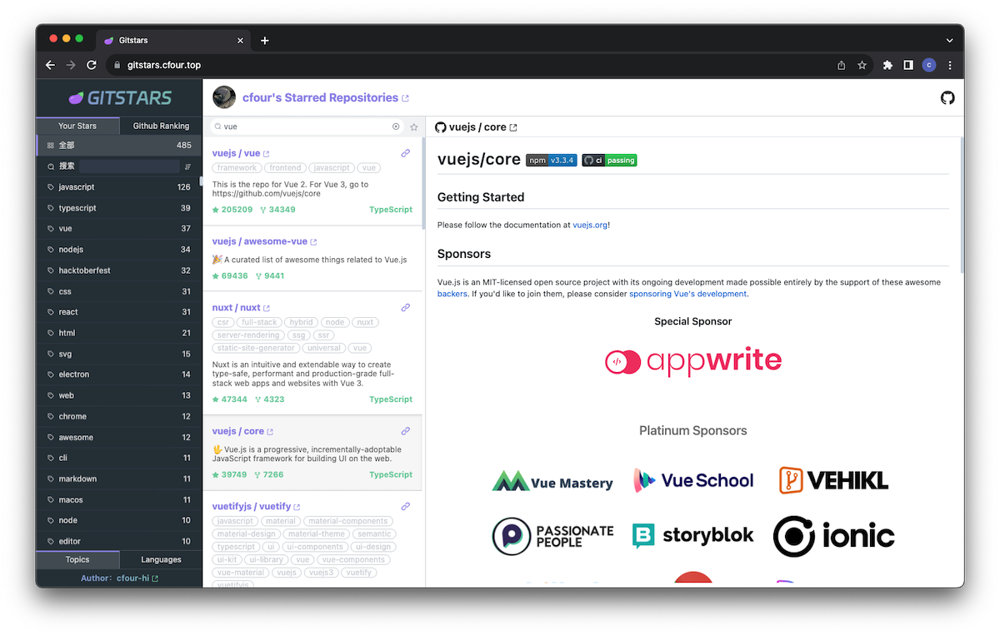
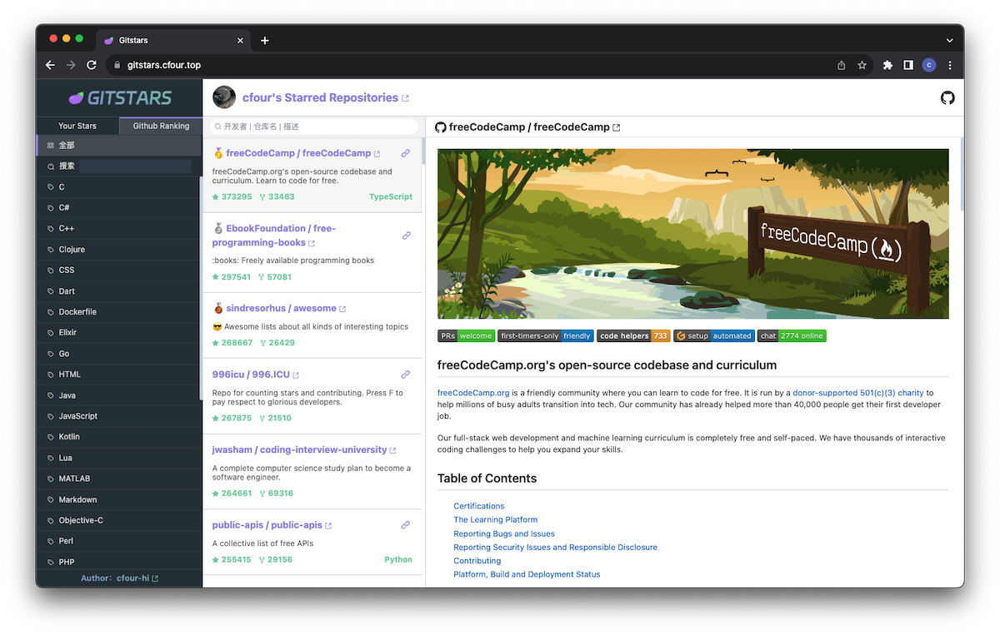
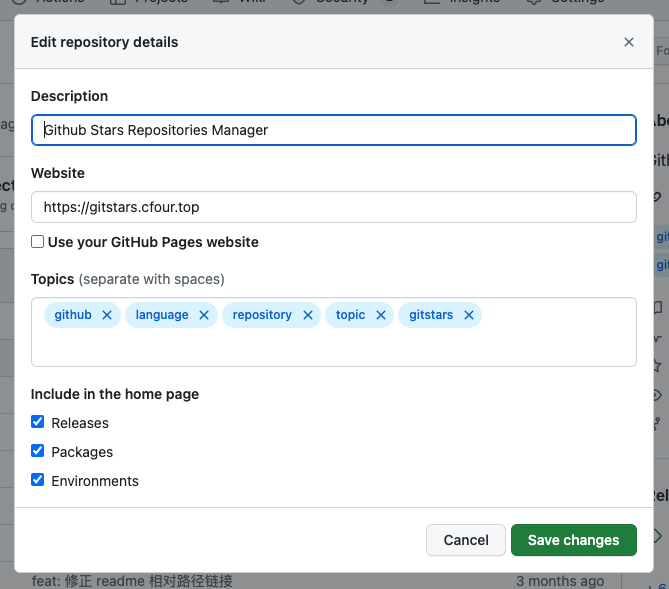
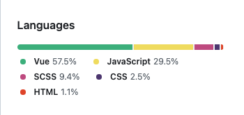

<div align="center">

[简体中文](./README.md) / [English](./README-EN.md)

A repository manager for organizing, searching, and browsing your GitHub Stars.

</div>

## What is Gitstars?

As your list of starred repositories grows, finding a project again becomes increasingly difficult with GitHub's built-in list alone. Gitstars syncs your public Stars and organizes them by Topics and programming language, making your saved repositories easier to search, filter, and revisit.

Gitstars also provides GitHub repository rankings grouped by programming language to help you discover open-source projects worth following.

## Features

- **Your Stars**: Sync and browse the repositories starred by the current GitHub account.
- **Automatic categories**: Group repositories by Topics and primary programming language.
- **Fast search**: Search by owner, repository name, or description.
- **Flexible sorting**: Sort by starred date or number of Stars.
- **Gitstars Ranking**: Explore the top 100 repositories for different programming languages.
- **README preview**: Read repository documentation without leaving Gitstars.
- **Direct links**: Open a GitHub repository or its project website quickly.
- **Chinese and English UI**: Switch languages directly in the application.

## Screenshots

### Your Stars

Organize and search your Stars by Topics and Language:



### Gitstars Ranking

Browse popular GitHub repositories by programming language:



### Topics and Language

Topics are maintained by repository authors and describe a project's purpose and technical areas:



Language is the primary programming language calculated by GitHub from the files in a repository:



## Local deployment with Docker

Docker deployments use HTTPS by default. [mkcert](https://github.com/FiloSottile/mkcert) is recommended for generating a locally trusted development certificate.

### Requirements

- Docker and Docker Compose
- mkcert
- A GitHub OAuth App

### 1. Create a GitHub OAuth App

Open [GitHub Developer Settings](https://github.com/settings/developers), create an OAuth App, and use the following local defaults:

| Setting                    | Local default            |
| -------------------------- | ------------------------ |
| Homepage URL               | `https://localhost:8080` |
| Authorization callback URL | `https://localhost:8080` |

The callback URL must exactly match the **protocol, host, and port** used in the browser. If you change the exposed Docker port through `GITSTARS_PORT`, update the callback URL to use the same port.

### 2. Configure environment variables

Copy the environment template:

```bash
cp .env.example .env
```

Edit `.env` and enter the OAuth App's Client ID and Client Secret:

```dotenv
VITE_GITSTARS_CLIENT_ID=your_github_oauth_client_id
GITHUB_CLIENT_SECRET=your_github_oauth_client_secret

GITSTARS_PORT=8080
GITSTARS_CERT_DIR=./.certs

# User the container runs as (see next step)
GITSTARS_UID=your_host_uid
GITSTARS_GID=your_host_gid
```

`GITSTARS_UID` and `GITSTARS_GID` select the user the container runs as. The development private key is stored with mode `0600`, so the container must run as the current host user to read it. Get the values from the commands below and replace the placeholders in `.env`:

```bash
id -u
id -g
```

### 3. Generate a local HTTPS certificate

```bash
./scripts/setup-local-https.sh
```

The script installs the local mkcert development CA and creates these files in `.certs`:

```text
.certs/localhost.pem
.certs/localhost-key.pem
```

The certificate covers `localhost`, `127.0.0.1`, and `::1`. The `.certs` directory is ignored by both Git and the Docker build context. Certificates are mounted read-only into the running container.

The script stores `localhost.pem` with mode `0644` and `localhost-key.pem` with mode `0600`, so only the current user can read the private key. If `GITSTARS_UID`/`GITSTARS_GID` in `.env` do not match the current user, the script prints a warning listing the exact values to add to `.env`.

### 4. Build and start the service

```bash
docker compose up -d --build
```

Once the service is running, open:

- Gitstars: [https://localhost:8080](https://localhost:8080)
- Health check: [https://localhost:8080/healthz](https://localhost:8080/healthz)

Check the service status and logs:

```bash
docker compose ps
docker compose logs -f gitstars
```

Stop the service:

```bash
docker compose down
```

## Environment variables

| Variable                  | Required | Default    | Description                                                                                               |
| ------------------------- | -------- | ---------- | --------------------------------------------------------------------------------------------------------- |
| `VITE_GITSTARS_CLIENT_ID` | Yes      | —          | GitHub OAuth App Client ID; embedded in the frontend during the build                                     |
| `GITHUB_CLIENT_SECRET`    | Yes      | —          | GitHub OAuth App Client Secret; injected only at container runtime                                        |
| `GITSTARS_PORT`           | No       | `8080`     | HTTPS port exposed on the host                                                                            |
| `GITSTARS_CERT_DIR`       | No       | `./.certs` | Directory containing `localhost.pem` and `localhost-key.pem`                                              |
| `GITSTARS_UID`            | No       | `1000`     | UID the Docker container runs as; set it to `id -u`, otherwise it cannot read the `0600` private key      |
| `GITSTARS_GID`            | No       | `1000`     | GID the Docker container runs as; set it to `id -g`                                                       |
| `VITE_API_PROXY`          | No       | —          | Local `pnpm dev` only; backend URL that `/api` requests are proxied to (for example, a deployed instance) |

Rebuild the image after changing `VITE_GITSTARS_CLIENT_ID`:

```bash
docker compose up -d --build
```

If only `GITHUB_CLIENT_SECRET` changes, recreate the container:

```bash
docker compose up -d --force-recreate
```

## OAuth troubleshooting

### `The redirect_uri is not associated with this application`

Gitstars uses the browser's current `location.origin` as the OAuth `redirect_uri`. Make sure the Authorization callback URL in the GitHub OAuth App exactly matches the address used to access Gitstars:

| Address used in the browser | Correct callback URL     |
| --------------------------- | ------------------------ |
| `https://localhost:8080`    | `https://localhost:8080` |
| `https://127.0.0.1:8080`    | `https://127.0.0.1:8080` |

The following values are not interchangeable:

- `http` and `https`
- `localhost` and `127.0.0.1`
- Different ports

Use the site root as the callback URL. Do not append `/api/oauth/access_token`.

### The browser does not trust the certificate

Generate and install the local certificate again, then restart the browser:

```bash
./scripts/setup-local-https.sh
```

Firefox uses a separate certificate store and might require the local mkcert CA to be trusted separately.

### Gitstars still redirects to the previous OAuth App after changing the Client ID

The Client ID is embedded in the frontend during the build. Rebuild after modifying `.env`:

```bash
docker compose up -d --build
```

## Local frontend development

Local development requires Node.js 20.19 or later and pnpm 12:

```bash
pnpm install
pnpm cert:local
pnpm dev
```

The Vite development server runs at `https://localhost:30000` by default and uses the same `.certs` directory as Docker. This port comes from the Vite development configuration and is independent of Docker's default port `8080`. Set `VITE_API_PROXY` when an OAuth API proxy is required.

The dev server binds to `localhost` only by default and is not exposed on every interface. Run `pnpm dev -- --host` when you need LAN or device access.

Common commands:

| Command             | Description                                    |
| ------------------- | ---------------------------------------------- |
| `pnpm dev`          | Start the Vite development server              |
| `pnpm build`        | Create a production build                      |
| `pnpm preview`      | Preview the production build                   |
| `pnpm cert:local`   | Generate and trust the local HTTPS certificate |
| `pnpm format`       | Format the code with Prettier                  |
| `pnpm format:check` | Check formatting (used by CI)                  |
| `pnpm lint`         | Run ESLint                                     |
| `pnpm test`         | Run the Node test suite in `tests/`            |

## Code quality

- `pnpm format` / `pnpm format:check`: Prettier with `prettier-plugin-tailwindcss` handles formatting and Tailwind class sorting.
- `pnpm lint`: ESLint (`eslint.config.js`, with the `eslint-plugin-vue` essential rules).
- `pnpm test`: Node.js built-in test runner; tests live in `tests/`.
- GitHub Actions (`.github/workflows/ci.yml`) runs format check, lint, tests and the production build on pushes to `main` and on pull requests.

## Vercel deployment

Set `GITHUB_CLIENT_SECRET` in the Vercel project environment variables (the legacy `VITE_GITSTARS_CLIENT_SECRET` name is still accepted), and set `VITE_GITSTARS_CLIENT_ID` in the build environment so the frontend can embed the client ID. For the remaining steps, see the [Vercel deployment Wiki](https://github.com/cfour-hi/gitstars/wiki/Vercel-%E9%83%A8%E7%BD%B2).

## Technology stack

- Vue 3, Vite, and Pinia
- Tailwind CSS
- GitHub REST API and OAuth
- Node.js HTTPS server
- Docker Compose

## Security notes

- `GITHUB_CLIENT_SECRET` is injected only into the running container. It is not included in frontend assets or the final image.
- Local certificates and private keys are stored in `.certs`. They are not committed to Git or included in the Docker build context.
- The local private key `.certs/localhost-key.pem` uses mode `0600` and the public certificate `.certs/localhost.pem` uses `0644`. Docker Compose runs the container with the host UID/GID via `user:`, so the private key permissions do not need to be relaxed.
- The OAuth access token is stored in the browser's LocalStorage. Use Gitstars only on trusted devices.
- Never commit `.env`, a Client Secret, or a local certificate private key.

## License

This project is released under the [MIT License](LICENSE).
