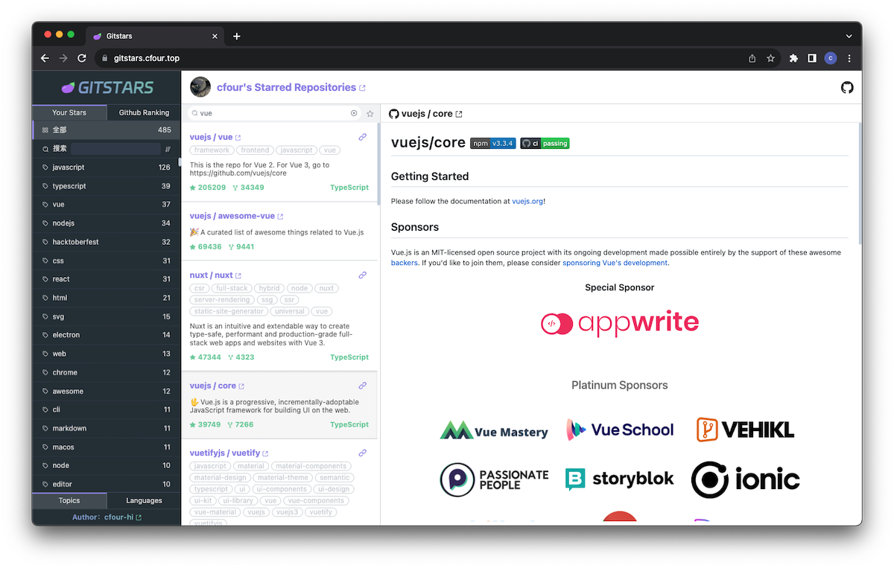

<div align="center">

[简体中文](./README.md) / [English](./README-EN.md)

</div>

Gitstars 是一个 GitHub Stars 管理工具。登录 GitHub 后，你可以按主题和编程语言筛选收藏、搜索仓库、预览 README，也可以浏览各语言的热门项目。

[在线体验](https://cfour-hi-gitstars.vercel.app/)

## 界面预览



**Your Stars** 支持按仓库所有者、名称和描述搜索，以及按收藏时间或 Star 数量排序。**Gitstars Ranking** 按编程语言展示热门仓库。界面支持中英文切换。[排行榜截图](docs/example-github-ranking.png)

## Docker 快速开始

需要 Docker、Docker Compose 和 [mkcert](https://github.com/FiloSottile/mkcert)。以下命令在仓库根目录运行。

### 1. 创建 GitHub OAuth App

新建 OAuth App，把 **Homepage URL** 和 **Authorization callback URL** 都填为 `https://localhost:8080`，然后取得 Client ID 和 Client Secret。[GitHub Developer Settings](https://github.com/settings/developers)

### 2. 配置环境变量

```bash
cp .env.example .env
id -u
id -g
```

在 `.env` 中填写以下变量。Client Secret 仅供服务端使用，请妥善保管 `.env` 和证书私钥。

| 变量                            | 值                                                                  |
| ------------------------------- | ------------------------------------------------------------------- |
| `VITE_GITSTARS_CLIENT_ID`       | OAuth App 的 Client ID，构建时写入前端                              |
| `GITHUB_CLIENT_SECRET`          | OAuth App 的 Client Secret，启动时注入容器                          |
| `GITSTARS_UID` / `GITSTARS_GID` | 分别填入 `id -u` / `id -g` 的输出，让容器能读取权限为 `0600` 的私钥 |
| `GITSTARS_PORT`                 | 宿主机 HTTPS 端口，默认 `8080`。修改后同步更新 OAuth 回调地址的端口 |
| `GITSTARS_CERT_DIR`             | 本地证书目录，默认 `./.certs`                                       |

### 3. 生成证书并启动

```bash
./scripts/setup-local-https.sh
docker compose up -d --build
```

脚本会信任 mkcert 的本地 CA，并在证书目录生成 `localhost.pem` 和 `localhost-key.pem`。启动后打开 [Gitstars](https://localhost:8080)，也可以访问 [健康检查](https://localhost:8080/healthz) 确认服务状态。

用 `docker compose logs -f gitstars` 查看日志，用 `docker compose down` 停止服务。

## 本地开发

推荐使用 Node.js 22.x（至少 22.13）和 pnpm 12.18.0，与 CI 的运行环境对齐。

```bash
pnpm install
pnpm cert:local
pnpm dev
```

Vite 默认在 `https://localhost:30000` 提供服务。测试 GitHub 登录时，在 `.env` 中将 `VITE_API_PROXY` 指向可用的 Gitstars OAuth 后端，例如 `https://localhost:8080`。使用与后端 Client Secret 配对的 Client ID，并把该 OAuth App 的回调地址设为开发页面的实际访问地址。

CI 依次运行 `pnpm format:check`、`pnpm lint`、`pnpm test` 和 `pnpm build`。

## Vercel 部署

导入仓库后，在 Vercel 项目的环境变量中设置 `VITE_GITSTARS_CLIENT_ID` 和 `GITHUB_CLIENT_SECRET`，并将 GitHub OAuth App 的回调地址设为部署站点的根地址。旧部署仍可使用 `VITE_GITSTARS_CLIENT_SECRET`，新部署请使用 `GITHUB_CLIENT_SECRET`。[Vercel 部署 Wiki](https://github.com/cfour-hi/gitstars/wiki/Vercel-%E9%83%A8%E7%BD%B2)

## 常见问题

- **GitHub 提示 `The redirect_uri is not associated with this application`**。回调地址应为浏览器访问的站点根地址，协议、主机和端口须一致。例如 `https://localhost:8080`。
- **浏览器不信任本地证书**。重新运行 `./scripts/setup-local-https.sh`，然后重启浏览器。Firefox 可能需要单独信任 mkcert 的本地 CA。
- **修改 OAuth 凭据后仍使用旧配置**。更换 Client ID 后运行 `docker compose up -d --build`。仅更换 Client Secret 时运行 `docker compose up -d --force-recreate`。

## 许可证

[MIT License](LICENSE)
